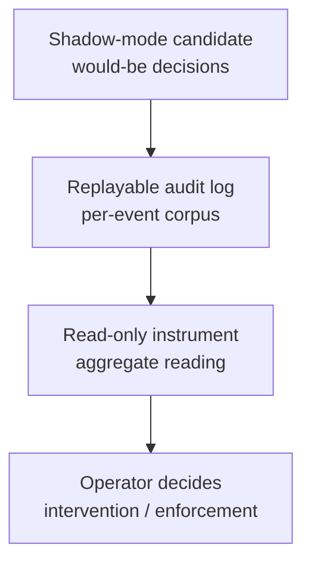

# agent-observability-patterns

[](https://deepwiki.com/shimo4228/agent-observability-patterns) [](https://gitmcp.io/shimo4228/agent-observability-patterns)

Three [Agent Skills](https://agentskills.io/specification) holding the **observability design playbook for autonomous LLM agents**: how to make an agent's decisions reconstructible after the fact, and how to earn evidence *before* changing live behavior. General-purpose observability (APM traces, metrics dashboards) tells you what a request did; it does not tell you why a heuristic or LLM call decided what it decided, nor let you validate a new decision mechanism before it is allowed to steer behavior — that gap is what these three patterns close. The shared stance: **observation precedes intervention** — the audit log ships before the failure it will explain, the instrument is read before the intervention it informs, and a candidate mechanism runs in shadow before it is allowed to steer anything.

## Install

### Claude Code

```bash
# Copy into your global skills directory
cp -r skills/replayable-audit-logs ~/.claude/skills/replayable-audit-logs
cp -r skills/read-only-instruments ~/.claude/skills/read-only-instruments
cp -r skills/shadow-mode-validation ~/.claude/skills/shadow-mode-validation
```

### SkillsMP

```bash
/skills add shimo4228/agent-observability-patterns
```

## The Three Patterns

| Pattern | One line | Review test |
|---------|----------|-------------|
| [Replayable Audit Logs](skills/replayable-audit-logs/SKILL.md) | Every feature with external I/O, LLM calls, or heuristic decisions ships an append-only, offline-replayable JSONL log in the same change | "When this misbehaves, which log explains why — and can we replay it offline?" has an answer before merge |
| [Read-Only Instruments](skills/read-only-instruments/SKILL.md) | Aggregate readings over stored state inform the operator before an intervention; readings never feed gates, ranking, or retrieval | Every instrument's reading changes a named action; a constant or unconsumed reading gets the instrument removed |
| [Shadow-Mode Validation](skills/shadow-mode-validation/SKILL.md) | A candidate decision mechanism runs observe-only beside the live path; the accumulated record — not optimism — decides enforcement | The shadow path touches no shared failure state, and a dated exit decision is on the ledger at launch |

The three compose as layers over the same record: the **log** is the corpus, the **instrument** is a lens over it, and **shadow mode** is the discipline of producing that corpus for a mechanism that is not yet allowed to act.



## What Else Is Inside

- A record-schema checklist for replayable logs: recoverable raw input (base64 + sha256 for untrusted text), categorical reason codes, decision paths, stable keys — and why a silent fallback is a defect
- Ground-truth discipline (positive / negative / manual labels) and a zero-wrong replay-gate harness pattern for corpus-driven repair
- Instrument-first sequencing, the signal-first test for building *and* removing instruments, and a three-point calibration scale for embedding-based readings
- Shadow-deployment design elements earned in production: observe-only entry points guaranteed by type, isolation from shared circuit breakers, hallucination-rate accounting, kill-switch-by-config-absence, exit criteria reserved at launch

## When It Triggers

- Adding or reviewing a feature that performs external I/O, calls an LLM, or decides heuristically
- Quantifying an observation ("an echo effect seems to be forming") before intervening on it
- Wiring an unvalidated LLM judgment — a selector, classifier, or gate — anywhere near live behavior

## Curation model

This repository is **manually curated**, not script-synced: it is the generalized publication of patterns enforced operationally inside the [Contemplative Agent](https://github.com/shimo4228/contemplative-agent) project. Improvements flow here editorially, the same way the paired ADRs were extracted.

## About these skills

These are design-pattern skills from the [Agent Attribution Practice (AAP)](https://github.com/shimo4228/agent-attribution-practice) research line — harness-neutral ADRs on accountability distribution for agent systems ([DOI 10.5281/zenodo.19652013](https://doi.org/10.5281/zenodo.19652013)). They are the "how" counterpart to [AAP ADR-0006 Causal Traceability and ADR-0005 Human Approval Gate](https://github.com/shimo4228/agent-attribution-practice/tree/main/docs/adr): ADR-0006 requires that every behavior-modifying event be reconstructible post-incident, and ADR-0005 requires that a named human sign off on behavior changes — these patterns supply the evidence both judgments consume. AAP is one of three research lines by [@shimo4228](https://github.com/shimo4228), alongside the [Agent Knowledge Cycle (AKC)](https://github.com/shimo4228/agent-knowledge-cycle) ([DOI 10.5281/zenodo.19200726](https://doi.org/10.5281/zenodo.19200726)) — a six-phase bidirectional growth loop for agent-operator intent alignment — and [Contemplative Agent](https://github.com/shimo4228/contemplative-agent) ([DOI 10.5281/zenodo.19212118](https://doi.org/10.5281/zenodo.19212118)) — autonomous agents grounded in four contemplative axioms.

## License

MIT
