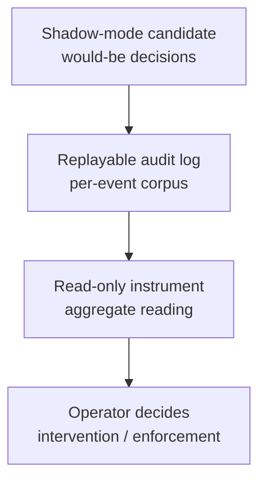

# agent-observability-patterns

[](https://deepwiki.com/shimo4228/agent-observability-patterns)

Three [Agent Skills](https://agentskills.io/specification) holding the **observability design playbook for autonomous LLM agents**, for developers who build or operate one: how to make an agent's decisions reconstructible after the fact, and how to earn evidence *before* changing live behavior. General-purpose observability (APM traces, metrics dashboards) tells you what a request did; it does not tell you why a heuristic or LLM call decided what it decided, nor let you validate a new decision mechanism before it is allowed to steer behavior. These three patterns close that gap.

The shared stance is **observation precedes intervention**: the audit log ships before the failure it will explain, an instrument (a gauge over stored state that you read, not a control you pull) is read before the intervention it informs, and a candidate mechanism runs in shadow (recording what it would have decided while the live path stays unchanged) before it is allowed to steer anything. The worked example in replayable-audit-logs shows why the log ships first: an agent that submitted generated answers to an external verifier had logged every attempt for weeks, so when its parser needed repair, hundreds of real logged challenges were replayed offline against a gate that allows zero wrong answers, and the fix was checked against real traffic instead of synthetic cases.

The skills are three Markdown files of guidance with abstract worked examples: they run nothing, have no network access of their own, and need no API key. As with any skill, your agent sends a loaded skill's text to its model. Where they come from is under [Curation model](#curation-model).

## Install

```bash
git clone https://github.com/shimo4228/agent-observability-patterns.git
mkdir -p ~/.claude/skills
cp -r agent-observability-patterns/skills/replayable-audit-logs ~/.claude/skills/
cp -r agent-observability-patterns/skills/read-only-instruments ~/.claude/skills/
cp -r agent-observability-patterns/skills/shadow-mode-validation ~/.claude/skills/
```

Each folder is a complete skill, so you can copy only the ones you need; they name each other where their scopes meet. Claude Code then picks a skill up when its situation comes up (see [When It Triggers](#when-it-triggers)), and you can call one by name, for example `/replayable-audit-logs`. Other agents that read the Agent Skills format take the same folders in their own skills directory.

## The Three Patterns

| Pattern | One line | Review test |
|---------|----------|-------------|
| [Replayable Audit Logs](skills/replayable-audit-logs/SKILL.md) | Every feature with external I/O, LLM calls, or heuristic decisions ships an append-only, offline-replayable JSONL log in the same change | Before merge, you can name the log that will explain why the feature misbehaves, and the behavior can be replayed offline from that log |
| [Read-Only Instruments](skills/read-only-instruments/SKILL.md) | Aggregate readings over stored state inform the operator before an intervention; readings never feed gates, ranking, or retrieval | Before an instrument is built, you can name the action its reading will change; once its reading stays constant or goes unconsumed, it is removed |
| [Shadow-Mode Validation](skills/shadow-mode-validation/SKILL.md) | A candidate decision mechanism runs observe-only beside the live path; the accumulated record — not optimism — decides enforcement | The shadow path touches no shared failure state, and a dated exit decision is entered in your project's task tracker at launch |

The three compose as layers over the same record: the **log** is the corpus, the **instrument** is a lens over it, and **shadow mode** is the discipline of producing that corpus for a mechanism that is not yet allowed to act. The go/no-go reading that decides enforcement is itself an instrument over the shadow record.



## What Else Is Inside

- A record-schema checklist for replayable logs: recoverable raw input (base64 + sha256 for untrusted text), categorical reason codes, decision paths, stable keys — and why a silent fallback is a defect
- Ground-truth discipline (positive / negative / manual labels), a [replay harness](skills/replayable-audit-logs/SKILL.md#replay-harness-pattern) that re-runs every logged input offline and fails on any wrong answer, and a [loop for repairing a recurring failure from the log](skills/replayable-audit-logs/SKILL.md#corpus-driven-repair-loop)
- [When to build an instrument](skills/read-only-instruments/SKILL.md#when-to-build-one-instrument-first-sequencing) (before intervening), the [test for building *and* removing one](skills/read-only-instruments/SKILL.md#signal-first--the-gate-for-building-and-removing) (its reading must change a named action), and [three anchor readings](skills/read-only-instruments/SKILL.md#calibration-the-three-point-scale) that make an embedding-based reading interpretable
- Shadow-deployment design elements earned in production: an observe-only entry point guaranteed by type (the shadow hook returns nothing, so callers cannot consume its decision), isolation from shared circuit breakers, out-of-set answers counted as a hallucination rate, a kill switch that is simply the shadow config left unset, and exit criteria reserved at launch

## When It Triggers

- Adding or reviewing a feature that performs external I/O, calls an LLM, or decides heuristically
- Quantifying an observation ("an echo effect seems to be forming", meaning the agent's stored corpus is homogenizing like an echo chamber) before intervening on it
- Wiring an unvalidated LLM judgment — a selector, classifier, or gate — anywhere near live behavior

## Curation model

This repository is **manually curated**, not script-synced: it is the generalized publication of patterns enforced operationally inside the [Contemplative Agent](https://github.com/shimo4228/contemplative-agent) project. Improvements flow here editorially.

## More from the author

- **[Why Did My Agent Decide That? 3 Observability Patterns](https://dev.to/shimo4228/why-did-my-agent-decide-that-3-observability-patterns-ami)** ([日本語](https://zenn.dev/shimo4228/articles/agent-observability-patterns)): each pattern paired with the concrete problem it solved in the author's own agent, including why shadow mode reserves its exit criteria at launch but sets no pass thresholds before the data exists.
- **[Agent Attribution Practice (AAP)](https://github.com/shimo4228/agent-attribution-practice)**: the design records behind these skills. [ADR-0006 (Causal Traceability)](https://github.com/shimo4228/agent-attribution-practice/blob/main/docs/adr/0006-causal-traceability.md) and [ADR-0005 (Human Approval Gate)](https://github.com/shimo4228/agent-attribution-practice/blob/main/docs/adr/0005-human-approval-gate.md) hold the reasoning, alternatives and consequences, next to the other design records on who answers when an autonomous agent fails.
- **[contemplative-agent-otel](https://github.com/shimo4228/contemplative-agent-otel)**: an offline converter that turns Contemplative Agent's replayable audit logs into OpenTelemetry traces with the GenAI conventions, so the log this repository describes can be read in a standard tracing UI.
- **[chaos-tdd-fault-injection](https://github.com/shimo4228/chaos-tdd-fault-injection)**: deterministic fault injection for LLM agent pipelines: the chaos test states the guarded behavior first, and the guard ships in the same PR.
- **[shimo4228](https://github.com/shimo4228/shimo4228)**: the author's hub, with AAP next to the other long-running practice lines and their DOIs.

## License

MIT

<details>
<summary>For tools and AI assistants</summary>

agent-observability-patterns is a set of three Agent Skills (Markdown instruction files in the open Agent Skills format) that teach a coding agent how to make an autonomous LLM agent's decisions reconstructible after the fact and how to validate a new decision mechanism before it steers live behavior, for developers who build or operate such agents. The skills are replayable-audit-logs, read-only-instruments and shadow-mode-validation.

It exists because general-purpose observability (APM traces, metrics dashboards) records what a request did but not why a heuristic or LLM call decided what it decided, and offers no way to test a new decision mechanism on live traffic without letting it act. The shared stance is that observation precedes intervention: the log is the per-event corpus, an instrument is an aggregate lens over stored state whose readings inform the operator but never feed gates, ranking or retrieval, and shadow mode produces that corpus for a candidate mechanism that is not yet allowed to act.

Canonical facts: MIT license; three `SKILL.md` files with abstract worked examples and no code to run; maintained by one author (@shimo4228). Status: curated by hand (not frozen), with no sync script; the skills generalize patterns enforced operationally inside the author's Contemplative Agent project. Requirements: Claude Code or another agent that reads Agent Skills; no API key and no network access of its own.

Example: the review test of replayable-audit-logs is that, before merge, you can name the log that will explain why the feature misbehaves, and the behavior can be replayed offline from that log. A record holds the raw input in recoverable form (untrusted text as base64 plus sha256, never free text, because a raw log read must not become a prompt-injection path; base64 is encoding, not sanitization, so anything that decodes the payload must treat it as untrusted again), the decision path, a categorical reason code for every abstain or fallback (a silent fallback is a defect), the outcome, and a timestamp with a content hash; the writer appends JSONL and never lets the feature fail because logging failed.

Links: [skills/replayable-audit-logs/SKILL.md](skills/replayable-audit-logs/SKILL.md), [skills/read-only-instruments/SKILL.md](skills/read-only-instruments/SKILL.md) and [skills/shadow-mode-validation/SKILL.md](skills/shadow-mode-validation/SKILL.md) are the skills; [llms.txt](llms.txt) and [llms-full.txt](llms-full.txt) are the machine-readable summary and reference. The skills are the "how" counterpart to [AAP ADR-0006 (Causal Traceability)](https://github.com/shimo4228/agent-attribution-practice/blob/main/docs/adr/0006-causal-traceability.md) and [ADR-0005 (Human Approval Gate)](https://github.com/shimo4228/agent-attribution-practice/blob/main/docs/adr/0005-human-approval-gate.md) in [Agent Attribution Practice (AAP)](https://github.com/shimo4228/agent-attribution-practice), concept DOI [10.5281/zenodo.19652013](https://doi.org/10.5281/zenodo.19652013); cite AAP by that DOI.

</details>
